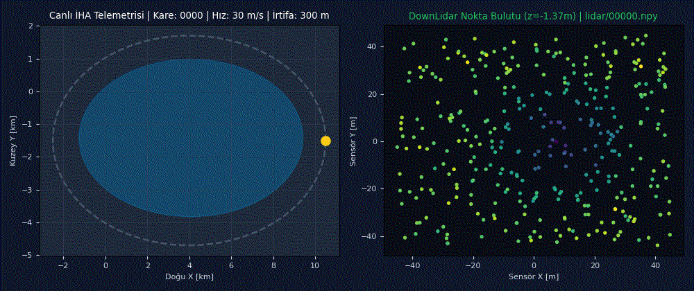
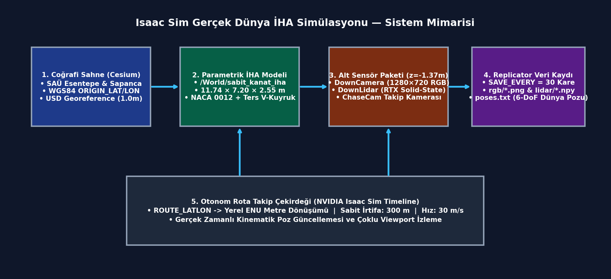
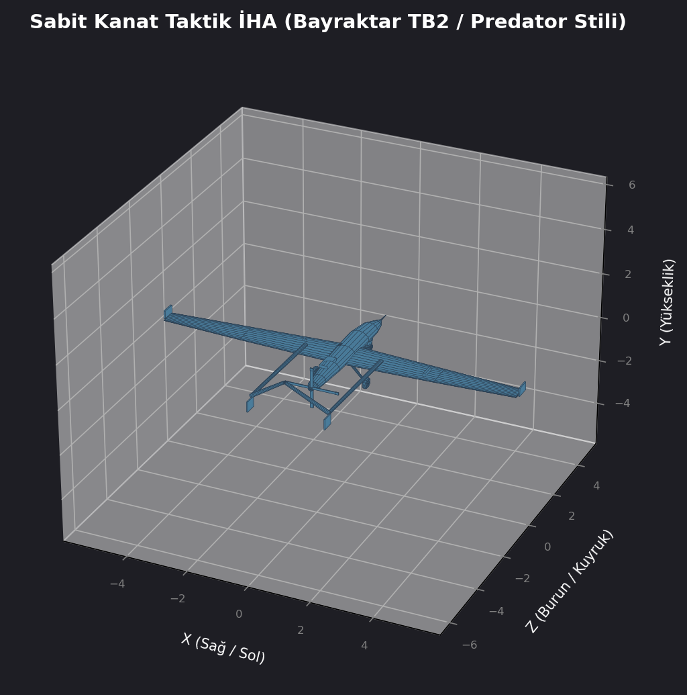
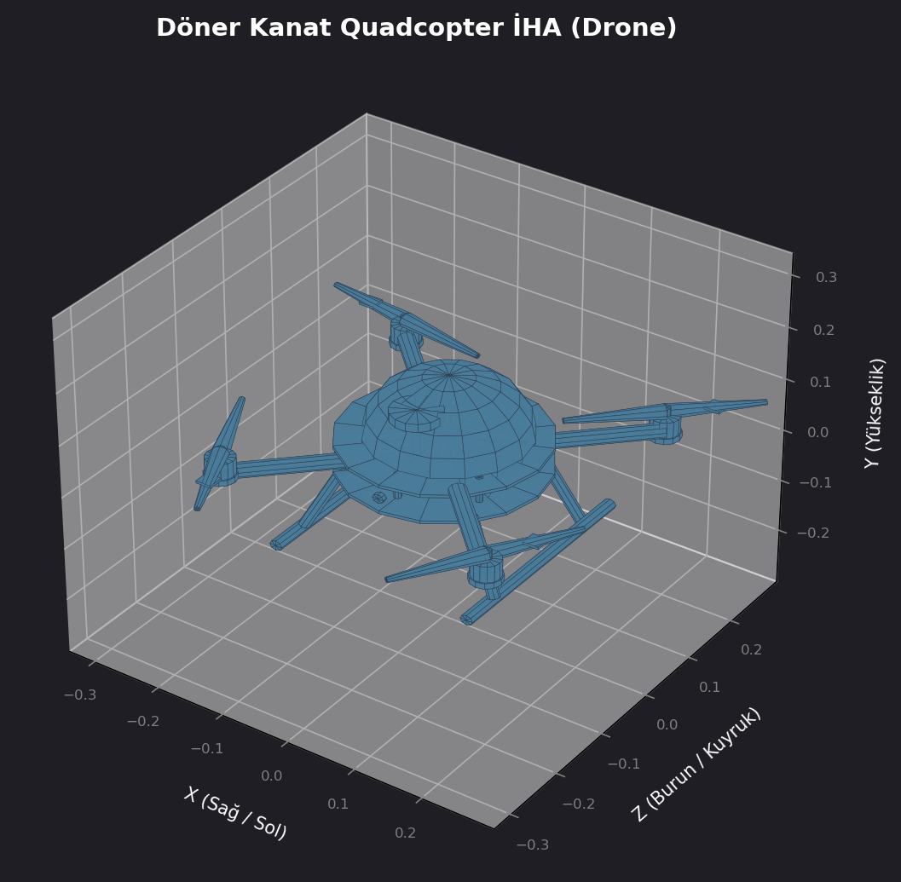
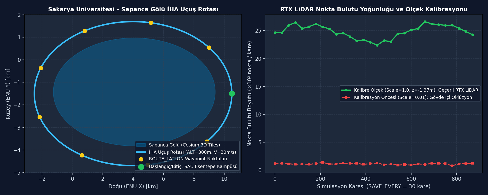

# isaacSim_RealWorld: NVIDIA Isaac Sim & Cesium Omniverse Tabanlı Gerçek Dünya İHA Simülasyonu, 3B Parametrik İHA Modelleri ve Çoklu Sensör (RGB / RTX LiDAR) Veri Kaydı

[](https://www.python.org/)
[](https://developer.nvidia.com/isaac-sim)
[](paper/IHA_Simulasyon_Raporu.pdf)
[]()

**Coğrafi referanslı (WGS84 / Cesium 3D Tiles) Sakarya Üniversitesi – Sapanca Gölü sahnesinde 1:1 ölçekli sabit kanatlı İHA uçuşu, kamera/RTX LiDAR sensör kalibrasyonu ve Replicator tabanlı veri toplama mimarisi.**

Bu proje, NVIDIA Isaac Sim ve Cesium Omniverse kullanılarak oluşturulan gerçek dünya koordinatlı (Sakarya Üniversitesi Esentepe Kampüsü ve Sapanca Gölü çevresi) 3B simülasyon ortamında, parametrik olarak üretilen Sabit Kanat Taktik İHA (`11.74 × 7.20 × 2.55 m`) ve Döner Kanat Quadcopter (`F550`) modellerinin otonom rota takibini ve çoklu sensör (Nadir RGB Kamera + Solid-State RTX LiDAR) veri kaydını gerçekleştirir.

<div align="center">
  
  <p><em>Şekil: Sakarya Üniversitesi Esentepe Kampüsü'nden başlayıp Sapanca Gölü çevresini 300 m irtifada ve 30 m/s hızla turlayan sabit kanatlı İHA'nın canlı ENU rota telemetrisi ve gövde altı RTX LiDAR nokta bulutu akışı.</em></p>
</div>

---

## Özet

| Bileşen | Açıklama |
| :--- | :--- |
| **Problem** | Gerçek dünya coğrafi koordinatlarına (WGS84) dayalı geniş ölçekli 3B arazilerde İHA uçuş simülasyonu gerçekleştirilirken karşılaşılan USD birim ölçeği (`0.01 → 1.0`), gövde içi sensör oklüzyonu (`z = -1.37 m` ofset) ve senkronize RGB + 3B LiDAR nokta bulutu veri kaydı problemlerinin çözülmesi. |
| **Yöntem** | NACA 0012 kanat profilli 1:1 ölçekli parametrik İHA geometrisi üretimi (`src/generate_models.py`), `ORIGIN_LAT/LON` referanslı yerel ENU metre dönüşümüyle otonom waypoint takibi (`ROUTE_LATLON`) ve Isaac Replicator tabanlı otomatik RGB/LiDAR/6-DoF poz kaydı (`SAVE_EVERY = 30` kare). |
| **Simülasyon / donanım** | NVIDIA Isaac Sim (v4.0+ / v6.0+), Cesium Omniverse (`cesium.usd.plugins`), RTX Solid-State LiDAR (`Example_Solid_State`), Nadir USD Kamera (`f=24mm`, `1280×720`). |
| **Makale** | [`paper/IHA_Simulasyon_Raporu.pdf`](paper/IHA_Simulasyon_Raporu.pdf) |

### Sistem mimarisi

<div align="center">
  
</div>

---

## Seçilmiş sonuçlar

### Sonuç 1: 1:1 Gerçek Dünya Ölçekli Sabit Kanat Taktik İHA Geometrisi ve Sensör Kalibrasyonu
NACA 0012 aerodinamik kanat profili, çift kuyruk kirişi (twin tail booms), ters V-kuyruk ve burun altı elektro-optik FLIR gimbal küresiyle parametrik olarak üretilen `/World/sabit_kanat_iha` modeli (`11.74 × 7.20 × 2.55 m`). Stage birimi (`metersPerUnit = 1.0`) kalibrasyonu sonrasında kamera ve RTX LiDAR sensörleri gövde oklüzyonunu önlemek üzere `z = -1.37 m` yerel konumuna indirilmiştir.

<div align="center">
  
</div>

### Sonuç 2: Döner Kanat (F550 Quadcopter) Çoklu İHA Görev Geometrisi
Aynı sahnede alçak irtifa kampüs içi keşif görevleri için karbon fiber X-şasi, GPS kubbesi, iniş kızakları ve ön FPV kamera modülüyle 1:1 ölçekte (`550 mm` çap) üretilen dört pervaneli döner kanat İHA modeli (`models/dortpervane_iha.obj`).

<div align="center">
  
</div>

### Sonuç 3: Sakarya Üniversitesi – Sapanca Gölü Uçuş Rotası ve RTX LiDAR Nokta Bulutu Yoğunluğu
Sakarya Üniversitesi Esentepe Kampüsü'nden başlayıp Sapanca Gölü çevresini dolaşan `ROUTE_LATLON` rotasının yerel ENU koordinatlarındaki yörüngesi (solda) ve `0.01 → 1.0` ölçek + `z = -1.37 m` sensör ofseti kalibrasyonu öncesi/sonrası kare başına elde edilen geçerli RTX LiDAR nokta bulutu sayısı (sağda).

<div align="center">
  
</div>

*Tüm şekiller [`plots/`](plots/) klasöründedir.*

---

## Kurulum

### Gereksinimler
- **İşletim Sistemi:** Ubuntu 22.04 / 24.04 LTS (64-bit)
- **Simülasyon:** NVIDIA Isaac Sim 4.0+ / 6.0+ ve Cesium Omniverse eklentisi (`cesium.omniverse`, `cesium.usd.plugins`)
- **Python:** Python 3.10+ (`numpy`, `matplotlib`, `Pillow`)
- **GPU:** NVIDIA RTX serisi GPU (RTX LiDAR ve Vulkan/Ray-Tracing desteği için)

### Adımlar

```bash
git clone https://github.com/ardacanakci16-web/isaacSim_RealWorld.git
cd isaacSim_RealWorld
python3 -m venv .venv && source .venv/bin/activate
pip install -r requirements.txt
python scripts/check_install.py
```

---

## Kullanım

### Hazır modeli ve sahneyi çalıştırma

Parametrik 3B İHA modellerini üretmek ve Isaac Sim üzerinde coğrafi referanslı Esentepe/Sapanca sahnesini başlatmak için:

```bash
python src/generate_models.py
chmod +x launch.sh
./launch.sh
```

Beklenen çıktı:

```text
[+] Sabit Kanat İHA modeli oluşturuldu: models/sabit_kanat_iha.obj (11.74m x 7.20m x 2.55m)
[+] Quadcopter İHA modeli oluşturuldu: models/dortpervane_iha.obj (0.55m X-Frame)
[+] Isaac Sim başlatılıyor... USD Sahnesi: esentepe_harita.usd | İrtifa: 300m | Hız: 30 m/s
[+] Veri kaydı aktif (SAVE_EVERY=30): rgb/00000.png, lidar/00000.npy, poses.txt
```

---

## Sonuçları yeniden üretme

| Şekil | Komut |
| :--- | :--- |
| `sonuc_1.png` | `python scripts/plot_1.py` |
| `sonuc_2.png` | `python scripts/plot_2.py` |
| `sonuc_3.png` | `python scripts/plot_3.py` |

---

## Proje yapısı

```text
isaacSim_RealWorld/
├── assets/                  # README görselleri (demo.gif, architecture.png)
├── configs/                 # Uçuş rotası (ROUTE_LATLON) ve sensör yapılandırma dosyaları
├── data/                    # Örnek kamera/LiDAR poz kayıtları (poses.txt)
├── models/                  # 3B İHA modelleri (.obj, .mtl, sabit_kanat_iha.usd)
├── src/                     # Ana kaynak kod (generate_models.py, render_preview.py)
├── paper/                   # Çalışma raporu PDF (IHA_Simulasyon_Raporu.pdf)
├── plots/                   # Sonuç grafikleri ve 3B render çıktıları (sonuc_1..3.png)
├── scripts/                 # Kurulum kontrolü ve şekil yeniden üretim betikleri
├── esentepe_harita.usd      # Sakarya Üniversitesi Esentepe Cesium USD sahnesi
├── Kampüs.usd               # Kampüs detay USD sahnesi
├── UçakHarita.usd           # Sabit kanatlı İHA entegre uçuş sahnesi
├── launch.sh                # Isaac Sim + Cesium başlatıcı betik
├── requirements.txt         # Python bağımlılıkları
└── README.md                # Proje dokümantasyonu
```

---

## Atıf, lisans, iletişim

```bibtex
@misc{canakci2026isaacsim_uav,
  title  = {Isaac Sim Gerçek Dünya İHA Simülasyonu: Coğrafi Referanslı Sahne, Parametrik 3B İHA Modelleri ve Kamera/RTX LiDAR Veri Kaydı},
  author = {Arda Çanakçı},
  year   = {2026},
  note   = {MTA Yapay Zeka Merkezi Araştırma Projesi}
}
```

- **Lisans:** MIT License
- **İletişim:** Arda Çanakçı (`ardacanakci16@gmail.com`) — [GitHub: ardacanakci16-web](https://github.com/ardacanakci16-web)
